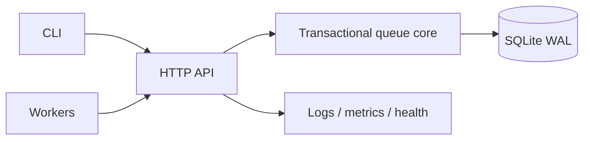

# Architecture

ChronosQueue v0.1 is intentionally a **single-server durable queue**: one Python server process, one SQLite database, and many concurrent remote workers. There is no leader election and no claim of multi-node coordination.

## Persistence and concurrency

All authoritative job state is persisted. In-memory state is used only for process-local counters. Every mutation opens an independent SQLite connection, enables foreign keys, WAL, `synchronous=FULL`, a busy timeout, and executes inside `BEGIN IMMEDIATE`. SQLite therefore serializes writers before claim selection and update, preventing two successful claim transactions from observing the same job as claimable.

A job lease carries an opaque 256-bit-class URL-safe token plus a monotonically increasing generation. The token is never returned by job-query endpoints. Completion/failure requires job ID, worker ID, and current token while `now < lease_expires_at`. At `now == lease_expires_at`, the lease is stale.

## Time

Persisted time is integer Unix microseconds. No ordering relies on textual timestamp width or local time. The core receives a `Clock`, allowing exact-boundary tests without sleeping.

## Claim order

Within the selected queues:

1. priority descending;
2. `available_at_us` ascending;
3. immutable creation sequence ascending.

## Recovery

Recovery is lazy and transactional: claim, heartbeat, cancellation, queue-statistics, and lease inspection first reconcile expired leases; claim also promotes due scheduled/retry-waiting jobs. Because recovery derives from persisted timestamps and state, process restart does not require an in-memory timer wheel to remain correct.

A lease consumes an attempt when granted. If it expires, the job returns to `ready` unless that attempt reached `max_attempts`, in which case it becomes `dead-lettered`.

## Cancellation race contract

Mutation serialization defines the winner. If cancellation commits first, lease credentials are cleared and subsequent completion is stale. If completion commits first, the job is `succeeded` and cancellation is rejected as an illegal transition. Expiry at or before the transaction's clock value invalidates completion/heartbeat.

## Pagination

Listing uses an immutable `seq` keyset plus a snapshot ceiling captured on the first page. Inserts after page one are excluded from that traversal, preventing offset drift, repeats, and insert-caused skips. State/tag filters are evaluated live; therefore a record that changes filter membership during traversal may appear or disappear according to its current state. This is intentionally not a database snapshot across HTTP requests.
