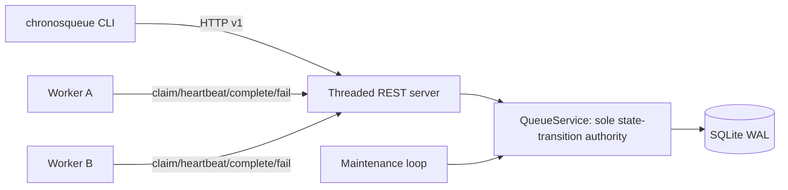

# Architecture

## Topology



There is one server process and one SQLite database. Every request gets a separate SQLite connection. Mutating operations use `BEGIN IMMEDIATE`, `foreign_keys=ON`, `busy_timeout=5000`, `synchronous=FULL`, and WAL mode. There is no Redis, broker, distributed lock, or in-memory source of truth.

## Persistent model

`jobs` contains the authoritative job state, schedule, attempts, lease metadata, retry policy, result/error, priority, tags, deduplication key, and terminal timestamp. Integer timestamps are UTC Unix microseconds, avoiding variable-width textual ordering bugs. `seq` is an immutable autoincrement tie-breaker.

`job_tags` provides exact tag filtering. `job_events` is an append-only transition/audit stream. `completion_receipts` makes completion and failure retries idempotent after ambiguous network outcomes. `metrics_counters` persists event counters across restart.

## State machine

```mermaid
stateDiagram-v2
  [*] --> ready: immediate submit
  [*] --> scheduled: delayed/absolute submit
  scheduled --> ready: scheduled_at <= now
  ready --> leased: claim
  leased --> succeeded: valid completion
  leased --> failed: worker failure (transaction-internal/audited)
  failed --> scheduled: retry budget remains
  failed --> dead-lettered: budget exhausted
  leased --> ready: lease expires, budget remains
  leased --> dead-lettered: lease expires on final attempt
  scheduled --> cancelled: cancel
  ready --> cancelled: cancel
  leased --> cancelled: cancel invalidates lease
  cancelled --> scheduled: explicit admin requeue
  dead-lettered --> scheduled: explicit admin requeue
```

The `failed` transition is recorded in `job_events`; worker failure is resolved to `scheduled` or `dead-lettered` in the same database transaction, so a committed job row does not linger in an ambiguous failed/retry-decision state.

## Lease invariant

A lease is valid iff all are true:

1. job state is `leased`;
2. worker ID matches;
3. opaque lease token matches;
4. lease generation matches;
5. current time is strictly less than `lease_expires_at_us`.

The schema requires all lease fields for `leased` rows and forbids them for every non-leased row. Writers are serialized at the SQLite transaction boundary. Claim selection is deterministic: `priority DESC, scheduled_at_us ASC, seq ASC`.

## Attempts and crash recovery

The attempt count increments exactly when a claim commits. A crashed worker therefore consumes the attempt it received. At lease expiry, maintenance or the next claim transaction requeues the job if budget remains; otherwise it dead-letters it. Recovery is derived entirely from persisted timestamps and state, so process restart does not require reconstructing an in-memory scheduler.

## Cancellation races

Mutations serialize through database transactions. If completion commits first, later cancellation is rejected because `succeeded` is terminal. If cancellation commits first, lease metadata is cleared and generation advances; later worker completion is stale. A claim may be returned just before a concurrent cancellation commits, but the returned token immediately becomes invalid and cannot complete the job.

## Pagination

List traversal is ordered by immutable `seq DESC`. The first page records `snapshot_max_seq`; later pages use both that upper bound and the last seen sequence. Inserts after page one are excluded and offsets cannot shift. Cursor data is bound to a hash of the filter set, so reusing a cursor with different filters fails.

Filter membership is live: a job that changes state during a multi-page state-filtered traversal may enter or leave that filter. ChronosQueue guarantees no offset-induced repeats and no inclusion of later inserts, not MVCC snapshot isolation across state changes.

## Trust boundary

HTTP is unauthenticated in v0.1. Host bind defaults to loopback. Request bodies, JSON finiteness, job IDs, worker IDs, retry values, priorities, payload size, result size, tags, lease durations, and cursors are bounded/validated. HTTP clients never supply filesystem paths.
